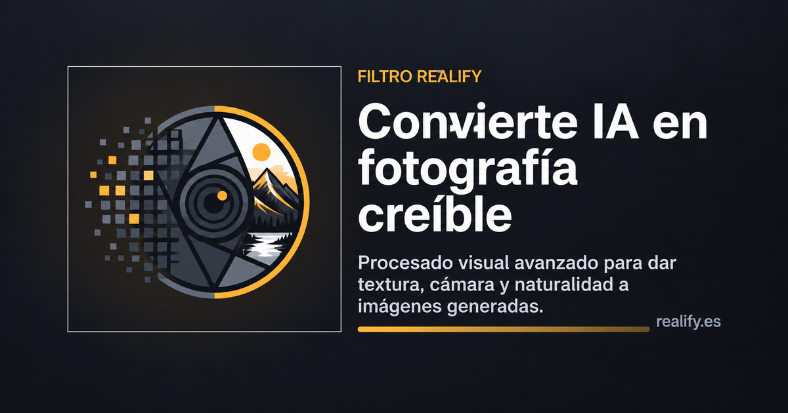

<div align="center">

<a href="https://realify.es">
  
</a>

# Realify

**Editor de imágenes profesional que funciona en el navegador. Sin instalación, sin cuenta y sin subir tus fotos a ningún servidor (salvo el respaldo opcional de «Panorámica», que sólo se usa si lo confirmas).**

[](https://realify.es)
[](LICENSE)
[](https://realify.es)


### [🚀 Abrir Realify en realify.es](https://realify.es)

[Características](#características-destacadas) ·
[Novedades](#novedades-recientes) ·
[Funcionalidades](#índice) ·
[IA local](docs/FUNCIONALIDADES.md#12-inteligencia-artificial-local) ·
[Desarrollo local](#19-despliegue) ·
[Contribuir](./docs/CONTRIBUTING.md) ·
[Registro de cambios](./docs/CHANGELOG.md)

</div>

<div align="center">

<br>

# 🎞️ 1.195 efectos distintos
## y más de **1.700 millones** de combinaciones apilando solo 3

*Cada filtro, estilo, cámara o efecto de color se aplica en su propia capa: se pueden **combinar, reordenar, mezclar y reeditar sin límite**, y el orden cambia el resultado.*

| Apilando… | Combinaciones distintas |
|:---:|:---:|
| **2** efectos | **1.426.830** |
| **3** efectos | **1.702.208.190** |
| **4** efectos | **2.029.032.162.480** · más de 2 billones |
| **5** efectos | **2.416.577.305.513.680** · más de 2 mil billones |

<sub>Sin contar los deslizadores de cada efecto, que lo vuelven prácticamente infinito. [Cómo se cuenta ↓](docs/FUNCIONALIDADES.md#cómo-se-calculan-las-combinaciones)</sub>

<br>

</div>

---

## Qué es Realify

Realify es un editor de imágenes completo que funciona en el navegador. Todo el
procesado —capas, filtros, revelado RAW, modelos de IA— ocurre en el equipo del
usuario: **las imágenes no se suben a ningún servidor**, con una excepción:
«Panorámica» une las fotos en tu dispositivo; sólo si falla puedes elegir enviarlas al servidor de Realify (no se guardan). Se instala como app
(PWA) y funciona sin conexión.

La versión pública está en **[realify.es](https://realify.es)**. Este documento
describe la versión **286** (ver la [lista de cambios](./docs/CHANGELOG.md)).

## Características destacadas

<table>
<tr>
<td width="50%" valign="top">

### 🎨 Edición por capas
Capas, grupos, máscaras, modos de fusión, estilos de capa, objetos
inteligentes y capas de ajuste y de filtro reeditables.

</td>
<td width="50%" valign="top">

### 📷 Revelado RAW de 16 bits
Más de 40 formatos RAW con LibRaw en WebAssembly, flujo lineal de 16 bits y
vista previa por GPU. Modo **Premium 👑**: Rec.2020, demosaico DHT, flujo de
escena en coma flotante, tono local sin halos y exportación TIFF de 16 bits.

</td>
</tr>
<tr>
<td valign="top">

### 🤖 IA local
Seleccionar sujeto, cielo y objetos por texto, eliminar fondo, rellenar y
expandir según el contenido, ampliar ×2/×4, colorear, reducir ruido, retocar
caras y estimar profundidad, sin enviar la imagen a nadie.

</td>
<td valign="top">

### ⚡ Aceleración por GPU
Filtros en WebGL2 y WebGPU, con alternativa en CPU y Web Workers para que
nunca falle un resultado.

</td>
</tr>
<tr>
<td valign="top">

### ✨ Creatividad
Fusión HDR de hasta 11 fotos, panorámicas, 160 estilos integrados más 151 estilos
por capas convertidos de acciones de Photoshop, 215 estilos vintage, **150 cámaras
de todas las épocas**, **226 efectos de color LUT**, 138 marcos, recortes en ~60 formas, memes, stickers, collages y publicaciones
para más de 29 formatos de redes sociales.

</td>
<td valign="top">

### 📱 Escritorio y móvil
Menús clásicos en escritorio; en móvil, un cajón de herramientas pensado para
el pulgar. Instalable y disponible sin conexión.

</td>
</tr>
</table>

### Principios

- **Sin instalación ni cuenta**: basta con abrir [realify.es](https://realify.es).
- **Privado por diseño**: el procesado es local; los modelos de IA se
  descargan y las imágenes no se suben (única excepción: «Panorámica», que las
  envía al servidor de Realify para unirlas, sin guardarlas).
- **Escritorio y móvil**: menús clásicos en escritorio; en móvil, barra
  inferior y un cajón de herramientas ordenado por objetivo (básicos,
  automáticos, mejorar, corregir, color, estilo…) con buscador tolerante a tildes y erratas. Los
  editores grandes se abren a pantalla completa, con la imagen primero y
  mandos pensados para el pulgar.
- **Sin dependencias ni compilación**: HTML, CSS y JavaScript con módulos ES.

## Novedades recientes

Resumen de las últimas versiones. El detalle completo está en el
[registro de cambios](./docs/CHANGELOG.md).

| Versión | Novedad |
|---|---|
| **v292** | **Panorámica con fotos de poco contraste** (cielo, niebla, paredes lisas): ya encuentra puntos de unión donde antes no colocaba ninguna foto. |
| **v291** | **Panorámica: costuras inteligentes y mezcla multibanda** (sin objetos a medias ni escalones de exposición). |
| **v290** | **Panorámica: corrige la distorsión de la lente** (la estima sola cuando hace falta y la deshace al unir). |
| **v289** | **Panorámica: ajuste de haces** — focal y giro de todas las fotos se refinan juntos con todas las coincidencias (más precisión en panorámicas largas y a pulso). |
| **v288** | **Panorámica más rápida** (ordenar las fotos es ~3× más rápido) y banco de medidas con hoja de ruta hacia el nivel de PTGui (`docs/PENDIENTE.md`, fase 21). |
| **v287** | **Panorámica en tu dispositivo**: las fotos se unen en el navegador (OpenCV.js, orden automático, cilíndrica/esférica, sin fantasmas); el servidor queda como respaldo opcional con confirmación. |
| **v286** | **Revisión de errores**: «Panorámica» avisa de que envía las fotos al servidor (política de privacidad corregida) y su servicio tiene límites; se retira del filtro Unmark el apoyo por servidor que no funcionaba; el despliegue ejecuta las comprobaciones antes de publicar. |
| **v285** | **Collage**: formas libres, miniaturas más grandes en móvil y zonas seguras de historias y TikTok. |
| **v284** | Barra de progreso: se oculta siempre, aunque falle el remuestreo o no cargue OpenCV. |
| **v283** | Guías del recorte («Ninguna», «Tercios», «Áurea») se redibujan al cambiarlas. |
| **v282** | **Recorte** con proporciones personalizadas grandes y la pantalla del iPhone 17 Pro Max. |
| **v281** | **Efectos LUT**: galería a pantalla completa con 226 efectos de color en 7 familias, miniaturas en vivo de tu foto y modo Premium (interpolación tetraédrica). |
| **v279** | **Cámaras** completa: 150 cámaras en 19 familias, de los procesos del siglo XIX a la compacta CCD, el cine, la TV de tubo, el fax o la cámara térmica. |
| **v277** | Las secciones **Filtros** y **Creativo** del cajón del móvil, también en el menú Filtro del escritorio. |
| **v275** | Pestaña **Creativo** en el cajón del móvil (editores a pantalla completa) y panorámica en el cajón. |
| **v274** | Pestaña **Filtros** en el cajón del móvil (looks de un toque). |
| **v273** | El buscador del menú del móvil se coloca encima del teclado (iPhone y Android). |
| **v272** | Pincel y herramientas de trazo con zoom en el móvil, pestaña **Capas** en el cajón, Transformar capa con vista previa, giro en Transformación libre, stickers persistentes y viñeteado rehecho. |
| **v271** | Panorámicas: alineado más fiable. Retirada la entrada de IA avanzada local. |
| **v261** | **Destellos de luz y bokeh** con sus texturas originales a 4000 px (50 en total), en modo Trama y como capa editable. |
| **v260** | **Estilos a pantalla completa** con buscador, Antes/Después y resultado en capa nueva. 138 estilos nuevos convertidos de acciones de Photoshop (`.atn`), con un motor de recetas por capas (151 en la versión actual). |
| **v259** | **Color por rangos**: cuentagotas y ocho círculos de color, control de **Difusión** del intervalo y modo Premium en OKLCh. |
| **v258** | **Restaurar caras** sustituye sólo el óvalo del rostro, sin tocar fondo, pelo ni orejas. Combinar capas acepta resultados de filtros e IA. |
| **v257** | **Color Display P3** en la pintura, **HEIC de 10 bits**, selección por texto de objetos pequeños y metadatos EXIF y XMP en OpenEXR. |
| **v256** | **«Fusionar si» por canal** (rojo, verde y azul) y PSD con texto y objetos inteligentes con giro, escala y sesgo. |
| **v255** | **Credenciales de contenido C2PA**: verificación de la firma en el inspector y «Firmar…» al exportar. |
| **v254** | **PDF profesional** con PDF/X, sangrado, marcas de corte, una página por capa, y PSD/PSB. |

## Índice

La referencia detallada de cada función está en **[docs/FUNCIONALIDADES.md](docs/FUNCIONALIDADES.md)**; el resto de este
documento describe el proyecto: estructura, pruebas, despliegue, tecnología y licencia.

1. [Archivos: abrir, guardar y exportar](docs/FUNCIONALIDADES.md#1-archivos-abrir-guardar-y-exportar)
2. [Edición e historial](docs/FUNCIONALIDADES.md#2-edición-e-historial)
3. [Herramientas](docs/FUNCIONALIDADES.md#3-herramientas)
4. [Imagen](docs/FUNCIONALIDADES.md#4-imagen)
5. [Selección y máscaras](docs/FUNCIONALIDADES.md#5-selección-y-máscaras)
6. [Capas](docs/FUNCIONALIDADES.md#6-capas)
7. [Texto](docs/FUNCIONALIDADES.md#7-texto)
8. [Ajustes de color y tono](docs/FUNCIONALIDADES.md#8-ajustes-de-color-y-tono)
9. [Filtros](docs/FUNCIONALIDADES.md#9-filtros)
10. [Calidad de color y precisión](docs/FUNCIONALIDADES.md#10-calidad-de-color-y-precisión)
11. [Modo Premium](docs/FUNCIONALIDADES.md#11-modo-premium)
12. [Inteligencia artificial local](docs/FUNCIONALIDADES.md#12-inteligencia-artificial-local)
13. [Módulos especiales](docs/FUNCIONALIDADES.md#13-módulos-especiales)
14. [Análisis y metadatos](docs/FUNCIONALIDADES.md#14-análisis-y-metadatos)
15. [Vista](docs/FUNCIONALIDADES.md#15-vista)
16. [App, privacidad y ayuda](docs/FUNCIONALIDADES.md#16-app-privacidad-y-ayuda)
17. [Estructura del proyecto](#17-estructura-del-proyecto)
18. [Pruebas](#18-pruebas)
19. [Despliegue](#19-despliegue)
20. [Tecnología](#20-tecnología)
21. [Compatibilidad](#21-compatibilidad)
22. [Contribuir](#22-contribuir)
23. [Licencias](#23-licencias)

---

## 17. Estructura del proyecto

```
index.html              Página principal
sw.js                   Service worker (red primero, caché de respaldo)
manifest.webmanifest    Manifiesto de la PWA
version.json            Número de versión publicado
.htaccess               Cabeceras, compresión y caché para Apache
css/                    Estilos: tokens, base, layout y móvil
js/
  main.js               Arranque: importa js/app/ y ejecuta la secuencia de inicio
  app/                  La aplicación: commands/ (un archivo por dominio: file, edit, image, layer…), atajos de
                        teclado, barra de herramientas, gestos del lienzo y barra de estado
  boot-guard.js         Vigilante de arranque (script clásico, se carga antes que la app)
  pwa.js                Instalación como app y actualizaciones
  core/                 Cimientos sin dependencias de nada superior: documento, historial, instantáneas, bus de
                        eventos, comandos, avisos (toast), vista, modos de fusión, color P3, ICC, dispositivo, búsqueda
    util/               Funciones pequeñas compartidas (limitar valores, escape de HTML, lectura de píxeles…)
  ui/
    kit/                Piezas de interfaz reutilizables: diálogos, shell de plugins (fsshell), interruptor Premium…
    help/               Guía (guide.js; topics/ tiene un archivo por tema), avisos legales, informe de errores, primeros pasos
    (raíz)              Menús, paneles, barras, cajón de herramientas del móvil
  editor/
    layers/             Árbol de capas, grupos, máscaras, estilos, capas de ajuste y de filtro, registro de filtros
    selection/          Selección, refinar borde, máscaras de luminosidad, pluma
    adjust/             Ajustes de color y tono (niveles, curvas, HSL, CLAHE, tono, color por rangos…)
    tools/              Herramientas del lienzo (tools.js es el registro; defs/ tiene una familia por archivo:
                        paint, select, move-liquify, crop-transform, text, shape…)
    text/               Texto: capas, edición, estilos y tipografías
    render/             Compositor (también en coma flotante, WebGL2 / WebGPU) y remuestreo
    (raíz)              Pestañas de documentos, portapapeles, alineación, operaciones de imagen
  filters/              Filtros especiales (camera, lens, lut, purepixel, unmark, segment)
    library/            Desenfoques, enfoque, distorsiones, efectos clásicos
    looks/              Estilos y looks
  features/             Sujeto, cielo, IA (texto, caras, profundidad, escáner, apilado), herramientas
                        fotográficas, paleta y acciones
  ai/                   Catálogo de modelos, carga y ejecución (ONNX), teselas, SAM, CLIPSeg, Zero-DCE++
  analysis/             Métricas, forense y FFT
  cv/                   OpenCV bajo demanda: alineación subpíxel, apilado, escáner de documentos, líneas
  exif/                 Lectura y escritura de EXIF, inspector, C2PA
  io/
    formats/            Códecs y formatos: PSD, TIFF, EXR, HEIC, JPEG XL, AVIF, ZIP, compatibilidad
    export/             Exportación: imagen, PDF, GIF, profesional
    meta/               Metadatos: lectura, edición, limpieza y credenciales de contenido
    precision/          Exportación en alta precisión (coma flotante por franjas)
    (raíz)              Abrir imágenes y proyectos
  lens/                 Corrección de lente (Lensfun y perfiles propios)
  vendor/               Librerías de terceros (ver js/vendor/ATTRIBUTIONS.md)
plugins/                Herramientas a pantalla completa, cada una con su código, estilos y recursos
  raw/                  Revelador RAW (LibRaw-Wasm)
  vintage/              Filtro Vintage
  cameras/              Galería de cámaras (motor WebGL2 propio)
  lut/                  Galería de efectos LUT (226 tablas .cube)
  memes/                Creador de memes
  social-post/          Collage / Historia / Post
  stickers/             Stickers (Fluent Emoji)
  hdr/                  Fusión HDR
  merge/                Unir imágenes (panorámica y unión)
  panorama/             Panorámica (se une en el dispositivo; respaldo opcional en server/panorama)
  slice/                Cortar en partes
  shape-crop/           Recortar en forma
  compare/              Antes y después
  contact-sheet/        Hoja de contactos
  batch/                Aplicar una edición a varias fotos
  frames/               Marcos
assets/                 Modelos de IA (models/), estilos (estilos/), cielos (skies/), perfiles de lente (lensdb/) e iconos
fonts/                  Tipografías libres (catálogo de Google Fonts), servidas desde el sitio
server/                 Servicios y configuración del VPS (no se sirve):
  nginx/                  plantilla de nginx (cabeceras, caché y carpetas ocultas)
  informe/                receptor de informes de error
  panorama/               servicio de panorámicas (FastAPI + OpenCV)
tests/                  Pruebas automáticas (ver la sección 18); tests/plugins/ las de cada plugin
tools/                  Herramientas de desarrollo: conversor de acciones .atn, base de datos de lentes, verificación
docs/                   Referencia de funciones (FUNCIONALIDADES.md), registro de cambios, despliegue, seguridad, contribución y pendientes
design/                 Imágenes de diseño originales (no se usan en la web)
log/                    Registros del servidor (vacía en el repositorio)
.github/workflows/      Despliegue automático en realify.es
```

### Capas del código

Un módulo sólo puede importar (de forma estática) de su capa o de las de abajo; `node tools/verify/layers.mjs` lo comprueba.

| Capa | Contenido |
|---|---|
| 0 · núcleo | `js/core/` |
| 1 · kit | `js/ui/kit/` |
| 2 · edición | `js/editor/`, `js/filters/`, `js/features/`, `js/io/`, `js/ai/`, `js/analysis/`, `js/exif/`, `js/lens/`, `js/cv/` |
| 3 · interfaz | `js/ui/` (menús, paneles, barras) |
| 4 · plugins | `plugins/` |
| 5 · app | `js/main.js`, `js/pwa.js`, `js/boot-guard.js`, `js/app/` |

Los `import()` dinámicos hacia arriba (carga diferida de un plugin, por ejemplo) están permitidos.

### Archivos divididos

Cuando un archivo grande se dividió por bloques, el archivo original se conserva como **fachada** (reexporta la misma API) y
sus partes viven en una carpeta con su nombre: `js/editor/adjust/adjustments.js` → `js/editor/adjust/adjustments/` (`levels.js`,
`curves.js`, `white-balance.js`…; lo que usan varios bloques está en `common.js`). Así ningún `import` existente cambia.


## 18. Pruebas

### Comprobaciones del proyecto (`npm run verify`)

Tras `npm install` (solo herramientas de desarrollo; la web no se compila), `npm run verify` encadena las comprobaciones de
`tools/verify/` (ver su [README](tools/verify/README.md)): reglas de capas, referencias sin resolver (ESLint), rutas, ciclos y
API de los módulos, y una prueba de humo en Chromium que abre la app, dibuja con el ratón, usa los atajos, abre cada diálogo y
plugin y compara los píxeles con la versión de partida. `npm run perf` mide el arranque con HTTP/2 y red limitada,
`npm run serve` sirve la web en local y `node tools/verify/docs-links.mjs` comprueba los enlaces de la documentación.

### Pruebas de herramientas

Las pruebas están en `tests/` y en algunas carpetas de herramientas. Se ejecutan con Node.js; la cabecera de cada
archivo indica su uso. La mayoría sirve el propio repositorio y necesita **Playwright con Chromium**.

```bash
node tests/calidad-herramienta.mjs adj.hsl     # calidad de una herramienta, en móvil y escritorio
node tests/rango-hsl.mjs                       # una prueba concreta
node tests/plugins/frames/test-marcos.mjs                    # regresión de los marcos
```

- **Calidad de herramienta** (`tests/calidad-herramienta.mjs <comando>`): ejecuta el comando de menú de la herramienta
  modificada sobre una imagen de detalle fino de 3000 × 2000 px, en móvil y en escritorio, y comprueba que el resultado
  tiene el tamaño del documento, coincide con el cálculo a resolución completa y no lanza errores. Termina con
  `APTO`, `APTO*` o `FALLO`. Una herramienta con `FALLO` no se publica.
- Algunos scripts `*_check.py` validan los archivos generados con bibliotecas de referencia (por ejemplo,
  c2pa-python o pillow-heif).

## 19. Despliegue

Es un sitio estático: basta con servir los archivos con cualquier servidor web.

- **Producción ([realify.es](https://realify.es))**: nginx. Cada push a `main`
  se publica automáticamente con GitHub Actions; ver [docs/DEPLOY.md](./docs/DEPLOY.md).
- **nginx**: la configuración de cabeceras de seguridad, compresión, caché y
  bloqueo de archivos internos está en
  [`server/nginx/nginx-realify.conf.example`](./server/nginx/nginx-realify.conf.example).
- **Apache**: el `.htaccess` hace lo mismo (nginx lo ignora).
- Hace falta **HTTPS** para el service worker y la instalación como app.
- Al cambiar archivos de la app, sincroniza el número de `VERSION`, `version.json`,
  `package.json` y `package-lock.json`, la constante de `sw.js` y los `?v=` de
  `boot-guard.js` y `main.js` en `index.html` para que los usuarios reciban la versión nueva.

Para probarlo en local, sirve la carpeta con cualquier servidor estático:

```bash
python -m http.server 8080
```

y abre `http://localhost:8080`.

### Servicio de panorámicas (opcional)

Las panorámicas de Realify se unen en el dispositivo del usuario. Como respaldo opcional (sólo si el usuario lo confirma tras un fallo local) existe un pequeño servicio en Python (FastAPI + OpenCV Stitcher) que corre en tu propio
servidor. La guía paso a paso, con la configuración de nginx y la solución de problemas, está en
[`server/panorama/README.md`](server/panorama/README.md).

## 20. Tecnología

| Área | Tecnología |
|---|---|
| Interfaz | HTML5, CSS con tokens de diseño, JavaScript con módulos ES (sin framework ni compilación) |
| Gráficos | Canvas 2D, **WebGL2** y **WebGPU**, con alternativa en CPU; compositor en coma flotante de 32 y 16 bits |
| Concurrencia | Web Workers y OffscreenCanvas |
| RAW | [LibRaw](https://www.libraw.org/) vía [LibRaw-Wasm](https://github.com/ybouane/LibRaw-Wasm) |
| IA | [ONNX Runtime Web](https://onnxruntime.ai/) (BodyPix, DeepLab, MobileNet, U²-Net, MODNet, ISNet, LaMa, SCUNet, FBCNN, MobileSAM + SAM, YuNet, BiSeNet, Depth Anything V2, GFPGAN, Zero-DCE++, CLIPSeg, SPAN, Real-ESRGAN, UltraSharp, SpongeColor, Colorizer, DDColor); profundidad y máscaras a resolución completa por bloques (`js/ai/tiles.js`) |
| Visión | [OpenCV.js](https://docs.opencv.org/) (alineación, apilado, escáner de documentos, líneas), base de lentes [Lensfun](https://lensfun.github.io/) |
| Formatos | [ag-psd](https://github.com/Agamnentzar/ag-psd), [UTIF.js](https://github.com/photopea/UTIF.js), [heic2any](https://github.com/alexcorvi/heic2any), [pdf-lib](https://pdf-lib.js.org/) y fontkit, [ExifReader](https://github.com/mattiasw/ExifReader), jSquash (AVIF y JPEG XL) |
| App | Service worker, Web App Manifest, IndexedDB |

Las licencias y atribuciones de cada librería están en `js/vendor/ATTRIBUTIONS.md`.

## 21. Compatibilidad

Realify funciona en las versiones actuales de Chrome, Edge, Firefox y Safari,
en escritorio y en móvil.

| Requisito | Uso |
|---|---|
| **WebGL2** | Imprescindible: filtros, revelado RAW y Filtro Vintage |
| **Módulos ES y Web Workers** | Imprescindibles: carga de la app y procesado en segundo plano |
| **WebGPU** | Opcional: acelera algunos modelos de IA; sin él se usa WebAssembly |
| **HTTPS** | Necesario para el service worker y la instalación como app |
| **HEVC (WebCodecs)** | Opcional: exportar HEIC y HEIC de 10 bits sólo donde el dispositivo tiene codificador |

## 22. Contribuir

Las contribuciones son bienvenidas. Antes de empezar, lee la
[guía de contribución](./docs/CONTRIBUTING.md) y el
[código de conducta](./docs/CODE_OF_CONDUCT.md).

- 🐞 ¿Has encontrado un error? [Abre un issue](../../issues/new?template=bug_report.yml).
- 💡 ¿Tienes una idea? [Propón una mejora](../../issues/new?template=feature_request.yml).
- 🔒 ¿Es un problema de seguridad? Sigue la [política de seguridad](./docs/SECURITY.md).

Los cambios de cada versión se recogen en el [CHANGELOG](./docs/CHANGELOG.md). Antes de
proponer un cambio en una herramienta, pasa su [prueba de calidad](#18-pruebas).

## 23. Licencias

El código propio de Realify se distribuye bajo la [PolyForm Noncommercial License 1.0.0](LICENSE).

**Realify puede usarse, estudiarse, modificarse y redistribuirse únicamente para fines no comerciales.** Cualquier uso con finalidad económica o comercial requiere autorización expresa del titular de los derechos.

Sin autorización expresa, no está permitido, entre otros usos:

- vender Realify o una versión modificada;
- cobrar por el acceso a una copia, fork o adaptación de Realify;
- integrar el código de Realify en un producto, aplicación o servicio comercial;
- ofrecer Realify o una adaptación como SaaS o servicio de pago;
- monetizar una copia o adaptación mediante publicidad, suscripciones, licencias u otros ingresos;
- revender o redistribuir comercialmente Realify bajo otra marca.

**El uso de la aplicación publicada en [realify.es](https://realify.es) está permitido para cualquier fin, también profesional o comercial** (por ejemplo, editar fotos propias o de clientes y usar el resultado libremente). Este permiso adicional del titular cubre sólo el uso de la web oficial; la licencia no comercial se aplica al código fuente y a sus copias o adaptaciones.

**Modelos de IA con licencia no comercial.** Realify es gratuito y no cobra por su uso. Estos modelos sólo
permiten el uso no comercial. Se incluyen con su licencia real, y **el usuario es responsable de cumplir la licencia
de cada modelo que utilice**:

| Modelo | Función | Licencia real | Fuente de la comprobación |
|---|---|---|---|
| BiSeNet (ResNet-18, `faceparsing`) | Seleccionar por texto (pelo, ojos, labios…) y Retoque de cara | Código y pesos: **MIT**. Los datos de entrenamiento CelebAMask-HQ son de **uso no comercial** | `assets/models/faceparsing/LICENSE.txt` y repositorio de origen |
| Zero-DCE++ | Iluminar con IA | **CC BY-NC 4.0** (Atribución-NoComercial 4.0 Internacional) | `assets/models/zerodce/LICENSE.txt` |
| UltraSharp V2 Lite (×4) | Ampliar con IA, Premium 👑 | **CC BY-NC-SA 4.0** (Atribución-NoComercial-CompartirIgual 4.0 Internacional) | Ficha del modelo en Hugging Face (Kim2091/UltraSharpV2) |

Otros modelos con licencia permisiva:

| Modelo | Función | Licencia real | Fuente de la comprobación |
|---|---|---|---|
| Real-ESRGAN (×4 v3 y anime ×4) | Ampliar con IA | BSD-3-Clause | Repositorio xinntao/Real-ESRGAN |
| CLIPSeg (pesos fp16) | Seleccionar por texto | Apache-2.0 (pesos); código MIT | Ficha CIDAS/clipseg-rd64-refined y repositorio timojl/clipseg |
| Resto de modelos de la tabla de la sección 12 (Depth Anything V2, MobileSAM/SAM, LaMa, ISNet, U²-Net, MODNet, DDColor, SCUNet, FBCNN, GFPGAN, BodyPix, DeepLab, MobileNet, YuNet, etc.) | Varias | Apache-2.0 o MIT según el catálogo `js/ai/models.js` | El catálogo; no lo he comprobado modelo a modelo |

**Sin comprobar:** SPAN ×2, SpongeColor Lite y Colorizer V2 se publican en OpenModelDB con la licencia que indique
cada ficha. No he podido consultarla desde aquí; hay que revisarla antes de distribuir la aplicación.


Los componentes de terceros conservan sus propias licencias y no quedan relicenciados por esta licencia:

- LibRaw-Wasm (ISC) y LibRaw (LGPL-2.1 / CDDL-1.0): ver `plugins/raw/NOTICES.md`.
- Fluent Emoji (MIT): ver `plugins/stickers/emoji/LICENSE`.
- Lensfun (CC BY-SA 3.0) para la base de lentes: ver `assets/lensdb/`.
- Poly Haven (CC0 1.0) para los cielos de `assets/skies/`.
- Resto de librerías: ver `js/vendor/ATTRIBUTIONS.md`.

Para solicitar autorización para un uso comercial de Realify, es necesario obtener una licencia o permiso independiente del titular de los derechos.

---

<div align="center">

**[realify.es](https://realify.es)** · Hecho con ❤️

</div>
